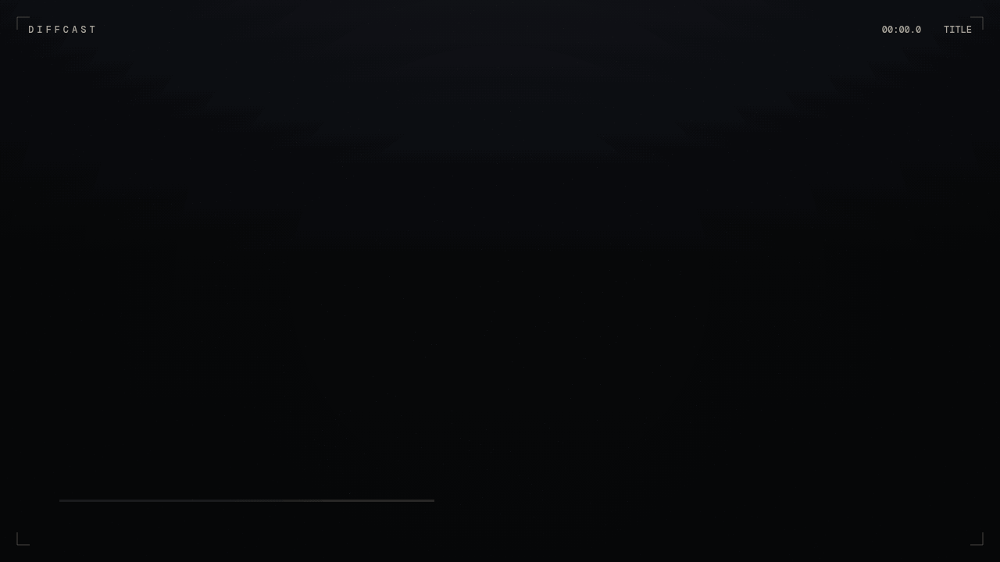

# Diffcast

[](LICENSE) [](https://diffcast-co.vercel.app) [](https://github.com/whynotartmoney/diffcast-co/stargazers)

**Carbon for motion.** Paste a GitHub compare URL, get a shareable cinematic diff reel.

**Live demo:** [https://diffcast-co.vercel.app](https://diffcast-co.vercel.app)

**Repository:** [https://github.com/whynotartmoney/diffcast-co](https://github.com/whynotartmoney/diffcast-co)



Diffcast turns a code change into a short film: a title card, the files that moved, the hunks themselves, one line held up to the light, and a last frame of the numbers. It runs in the browser. Export a GIF. Nothing to install.

The three reels on the landing page are curated highlights of public releases — React 16.8, Next.js 13, and Svelte 5. They play with the network off. A public GitHub compare, commit, or pull URL can be fetched without a token; if GitHub refuses, paste the before and after instead.

## Try it locally

The same app is already running at [https://diffcast-co.vercel.app](https://diffcast-co.vercel.app). To run it on your machine:

```bash
npm install
npm run dev
```

Open [http://127.0.0.1:43219](http://127.0.0.1:43219).

- Pick a canned reel, or paste a compare URL, or paste two snippets.
- Space plays and pauses. Arrow keys scrub. The slider does too.
- **Export GIF** writes a looping 1280×720 cut, about 8 seconds, entirely in the browser.
- **Copy link** puts the reel in the query string (demos and GitHub URLs) or the hash (pasted snippets, compressed).

```bash
npm run build
npm start
```

No environment variables are required. Demos never call GitHub.

## Deploy on Vercel

Production: [https://diffcast-co.vercel.app](https://diffcast-co.vercel.app).

Import the repository. Framework preset: Next.js. Build command: `npm run build`. Leave environment variables empty.

`/api/compare` calls the public GitHub API with [Octokit](https://github.com/octokit/rest.js) and no token. Unauthenticated traffic is rate-limited; the canned reels and paste mode do not use that route. Private repositories are intentionally unsupported.

## What’s in the reel

| Beat | What you see |
| --- | --- |
| Title | Repository, range, message |
| Files | What changed, with additions and deletions |
| Hunks | One or two hunks, syntax-colored, line by line |
| The line | A single declaration, held |
| Stats | Added, files, removed |

Playback is the full cut. The GIF is a tighter 8 second version of the same scenes, drawn by the same canvas renderer (`lib/render-reel.ts`).

## Good first issues

1. **Another language in the highlighter.** `lib/highlight.ts` is a scanner for the reel, not a full grammar. Python decorators or Rust lifetimes are a contained change.
2. **A 9:16 frame.** The timeline in `lib/timeline.ts` is independent of the 1280×720 stage. A portrait layout for `renderReel` is the natural follow-up.
3. **WebM alongside GIF.** `lib/export-gif.ts` is the export boundary. A `MediaRecorder` path can sit next to it for longer reels.
4. **A `?` shortcut map.** Space and arrows already work in `components/studio.tsx`. An overlay is unowned.
5. **Another canned reel.** Add a `DiffReel` in `lib/demos.ts`. Keep it short — a highlight, not a whole release.

## Project map

```
app/page.tsx            landing studio
app/api/compare/route.ts  public GitHub compare / commit / pull
components/studio.tsx   paste, play, scrub, share
components/reel-stage.tsx canvas playback
lib/render-reel.ts      scenes (also used by the GIF)
lib/timeline.ts         beat timing
lib/demos.ts            offline reels
lib/export-gif.ts       gifenc, shared palette
```

## 繁體中文

[MIT](LICENSE) · [線上示範](https://diffcast-co.vercel.app) · [GitHub Stars](https://github.com/whynotartmoney/diffcast-co/stargazers)

**一句話：** 貼上 GitHub compare URL，得到一支可分享的差分短片。

**線上示範：** [https://diffcast-co.vercel.app](https://diffcast-co.vercel.app)

**GitHub repo：** [https://github.com/whynotartmoney/diffcast-co](https://github.com/whynotartmoney/diffcast-co)

Diffcast 把程式碼變更剪成一支短片：片頭、動過的檔案、逐段 hunk、被放大的那一行，最後是新增與刪除的數字。全部在瀏覽器裡完成，可匯出 GIF，不用安裝。

首頁內建三支著名公開發行的精選片段（React 16.8、Next.js 13、Svelte 5），斷線也能播放。也可以貼公開的 compare、commit 或 pull URL；GitHub 若拒絕（速率限制、私人倉庫），改貼 before / after 程式碼即可。私人倉庫不在這個版本的範圍裡。

### 本地執行

線上示範已在 [https://diffcast-co.vercel.app](https://diffcast-co.vercel.app)。本機執行：

```bash
npm install
npm run dev
```

打開 [http://127.0.0.1:43219](http://127.0.0.1:43219)。空白鍵播放／暫停，方向鍵微調時間軸，滑桿也可以。**Export GIF** 會在瀏覽器裡做出約 8 秒、1280×720 的循環 GIF。**Copy link** 把示範與 GitHub URL 放在 query，把貼上的程式碼壓縮進 hash。

### 部署到 Vercel

目前部署：[https://diffcast-co.vercel.app](https://diffcast-co.vercel.app)。

匯入這個 repo，框架選 Next.js，建置指令 `npm run build`。不需要任何環境變數。`/api/compare` 用未驗證的 Octokit 讀公開 GitHub API；示範片段與貼上模式不依賴它。

### 適合新手的議題

- 在 `lib/highlight.ts` 補一種語言的著色
- 直式 9:16 畫面（時間軸與像素分開，見 `lib/timeline.ts`）
- 在 `lib/export-gif.ts` 旁邊加 WebM
- `?` 快捷鍵說明
- 在 `lib/demos.ts` 再加一支精選 reel

## License

[MIT](LICENSE)
